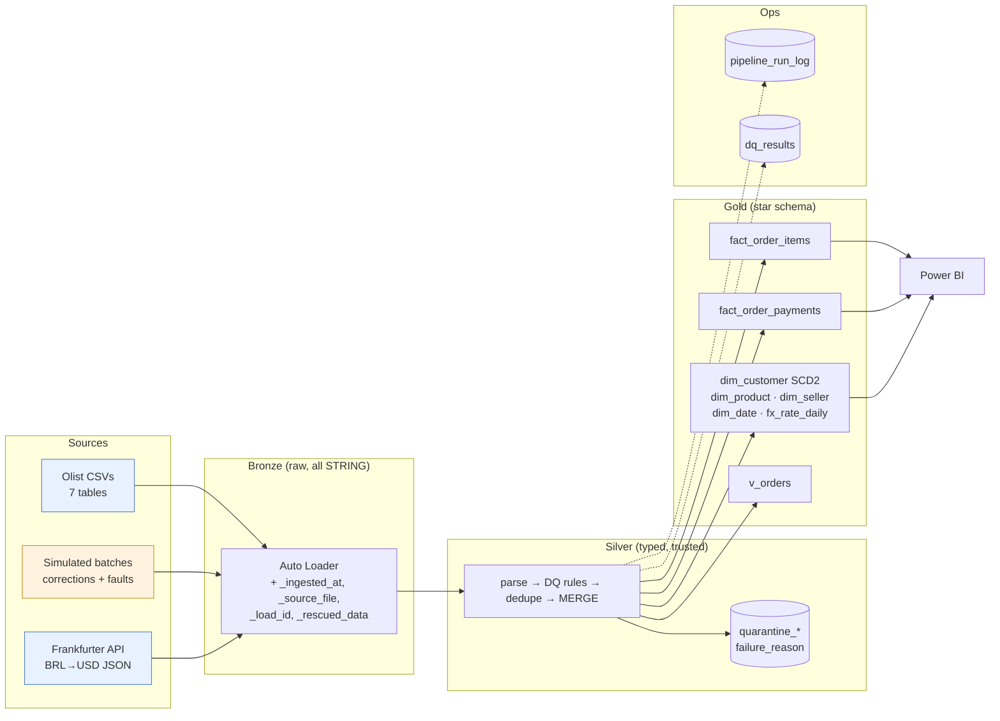
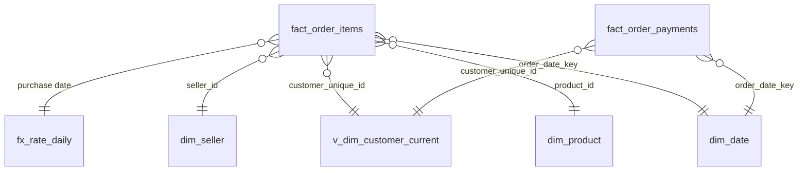

# Order-to-Cash Lakehouse on Databricks

An **order-to-cash-style simulation** built on the Databricks Lakehouse. Raw e-commerce orders, order items, payments, customers and products, plus daily FX rates from a REST API, move through **Bronze → Silver → Gold** layers. Along the way the pipeline runs data-quality rules and quarantines bad rows, loads incrementally without creating duplicates, keeps SCD Type 2 customer history, and writes every run to an audit trail. The Gold star schema is ready for Power BI.

**Tech:** Databricks (Free Edition, serverless) · PySpark · SQL · Delta Lake · Unity Catalog · Auto Loader · REST API (JSON) · Databricks Jobs / Asset Bundles · pytest + GitHub Actions · Power BI

[](https://github.com/ANISHTWAGLE/order-to-cash-lakehouse/actions/workflows/tests.yml)

## Architecture



The pipeline runs as one Databricks Job: `bronze_ingestion → silver_transformations → gold_star_schema → dq_checks → table_maintenance`. The Job runs on serverless compute, emails on failure, and has a daily schedule (created paused).

## Data sources

| Source | Real or simulated | Notes |
|---|---|---|
| Olist Brazilian E-Commerce (Kaggle) | **Real** | Orders, items, payments, customers, products, sellers, and the category translation. About 99k orders from Sep 2016 to Oct 2018. Not committed to the repo. |
| Frankfurter API (ECB reference rates) | **Real** | BRL→USD daily rates in **one** date-range request. A copy is kept in `data/fx/` in case outbound internet is blocked. |
| `data/simulated/` | **Simulated** | Written by `tools/generate_simulated_batches.py`. A correction batch (status updates and customer address moves) and a fault batch (duplicate, missing ID, malformed date, late-arriving order, bad status, negative price, orphan item, extra column, renamed column). Every ID starts with `sim`. |

**Scope:** Olist is an e-commerce dataset, **not** an SAP extract. This project simulates the order-to-cash flow (order → items → payment), using item revenue and payment value. It does **not** implement SAP invoicing or cash application.

## Star schema



| Table | Grain (one row per…) |
|---|---|
| `fact_order_items` | order item (`order_id`, `order_item_id`): price, freight, USD amounts |
| `fact_order_payments` | payment record (`order_id`, `payment_sequential`) |
| `dim_customer` | customer **version**: SCD2 on `customer_unique_id`, using `valid_from`, `valid_to` and `is_current` |
| `dim_product` / `dim_seller` / `dim_date` | product / seller / calendar day |
| `fx_rate_daily` | calendar day; weekends and holidays carry the last published rate forward |
| `v_orders` (view) | order: status, delivery days, item total vs payment total |

**Items and payments are never joined into one table.** An order with 2 items and 2 payments would become 4 rows and double the revenue. `sql/validation_queries.sql` (query 2) shows how much that naive join inflates revenue.

**Olist pitfall:** `customer_id` is new for **every order**. The real customer is `customer_unique_id`, so `dim_customer` is keyed on it.

## Data quality

The rules live in `src/quality_rules.py`. Each is a small named function with pytest coverage. A row that fails a rule goes to `silver.quarantine_<entity>` with its **raw** values and a `failure_reason`. Rows are never silently dropped.

| Rule | Action |
|---|---|
| Missing key (`order_id`, `customer_id`, `product_id`, `order_item_id`, …) | Quarantine `missing_key` |
| Value present but not a valid timestamp (e.g. `2018-13-45 99:00:00`) | Quarantine `invalid_timestamp` |
| Value present but not a valid number | Quarantine `invalid_number` |
| Negative price, freight, payment or dimension | Quarantine `negative_value` |
| Order status not in the allowed list | Quarantine `invalid_status` |
| Item or payment whose order is not in Silver | Quarantine `orphan_order_item` / `orphan_order_payment` |
| Duplicate business key | Keep the latest `_ingested_at` and count the rest in `dq_results` |
| Columns outside the contract (extra or renamed) | Kept in `_rescued_data` and counted in `dq_results` |
| Delivered before purchased; delivered without a date | Flagged in `dq_results`, row kept |
| Item total ≠ payment total per order | Reported as a finding, not forced to match |
| **Bronze in = Silver merged + quarantined + deduplicated** | Checked for every entity on every run (critical) |
| Gold fact counts and money = Silver; no NULL FX rate; one current SCD2 row per customer | Critical: if any fails, the Job fails |

Bronze stores every column as **STRING** on purpose. If Bronze cast a column to timestamp, a malformed date would quietly become NULL and the `invalid_timestamp` rule could never fire.

### What profiling found in the real Olist files

Counted locally with pandas from the original Kaggle CSVs:

- 99,441 orders, 112,650 order items, 103,886 payments, 32,951 products. No duplicate keys in the source.
- **775 orders have no items**, and **8 orders are `delivered` but have no delivery date**.
- **378 orders** have an item total (price + freight) that differs from the payment total by more than 0.01.
- **610 products have no category**. **2 categories** (`pc_gamer`, `portateis_cozinha_e_preparadores_de_alimentos`) are missing from the translation file.
- Payments include **3 `not_defined` types**, **9 zero-value payments** and **2 with 0 instalments**.
- The products header misspells *length* as `lenght`, which is renamed in Silver.
- The category translation file starts with a UTF-8 BOM, which is stripped on release.

## Incremental loading and idempotency

- **Bronze:** Auto Loader (`cloudFiles`, `availableNow`) keeps a checkpoint of the files it has processed, so re-running ingests nothing twice. `COPY INTO` is a built-in fallback.
- **Silver:** each run processes only Bronze rows newer than that entity's watermark. It loads them with `MERGE … WHEN MATCHED AND s._ingested_at > t._ingested_at`, so a correction updates the existing row and a stale or replayed row never rolls data back.
- **Gold:** facts are rebuilt from Silver with `CREATE OR REPLACE`, which is idempotent and cheap at this size. `dim_customer` is maintained incrementally as SCD2.
- **Late-arriving data:** a 2016 order arriving in a 2018 batch is inserted, gets the 2016 FX rate, and lands in the 2016 date bucket.

## Performance

At about 100k orders the tables are **not partitioned**, because partitions only pay off at much larger sizes. The facts use **liquid clustering** on `order_date_key` instead. `07_table_maintenance` runs `OPTIMIZE` and logs file counts before and after. Bronze gains one small file per monthly batch, so this compaction is real. The same notebook shows `DESCRIBE HISTORY`, time travel with `VERSION AS OF`, and an `EXPLAIN` plan with timing.

## How to run

The step-by-step guide is in [`docs/how_to_run.md`](docs/how_to_run.md). In short:

1. In Databricks, use **Workspace → Create → Git folder** and paste this repo's URL.
2. Run `notebooks/00_platform_check`, then `00_setup_catalog_schemas`. Upload the Olist CSVs to the Volume path it prints.
3. Run `02_release_incoming_batches` with `release = initial`, then `08_create_job`. This creates the Job and runs it.
4. Release `remaining`, then `simulated_correction`, then `simulated_faults`, and re-run the Job after each release.

Locally: `pip install -r requirements.txt && pytest`. You need Java 17+. The same tests run in GitHub Actions on every push.

## Results

> Only numbers from real runs go here.

| Evidence | Result |
|---|---|
| Initial run: rows ingested per entity, Gold built | `<FILL AFTER RUN>` |
| Re-run of the same files: new Bronze rows | `<FILL AFTER RUN>` (expected 0) |
| `remaining` batch: only new months ingested | `<FILL AFTER RUN>` |
| Correction batch: orders updated, dim_customer versions opened | `<FILL AFTER RUN>` (expected 20 updates, 5 new versions) |
| Fault batch: quarantine by reason | `<FILL AFTER RUN>` |
| Bronze = Silver + quarantined + deduplicated, every entity | `<FILL AFTER RUN>` |
| Fact counts and revenue = Silver | `<FILL AFTER RUN>` |
| OPTIMIZE file counts (bronze.orders before → after) | `<FILL AFTER RUN>` |

Screenshots are in [`docs/screenshots/`](docs/screenshots/).

## Repo layout

```
src/            pure Python + PySpark logic (config, DQ rules, parsing, FX, SQL builders)
notebooks/      thin Databricks notebooks that call src/ (00–09)
sql/            validation queries (ROW_NUMBER, LAG, NULL handling) and order-level views
tests/          pytest (runs PySpark locally and in GitHub Actions)
tools/          simulated-batch generator
data/           FX fallback JSON and simulated batches (real Olist data is not committed)
docs/           architecture, data dictionary, source-to-target mapping, runbook, how-to-run, Power BI
dashboard/      dashboard SQL (and Power BI file once built)
databricks.yml  the Job as a Databricks Asset Bundle
```

## Limitations

- This is an e-commerce dataset modelled as order-to-cash. It is not SAP data and has no invoicing or cash application.
- The correction and fault batches are **simulated** and clearly labelled.
- The data is small, so there is no partitioning. Performance numbers come from Free Edition serverless and say nothing about large-scale behaviour.
- Free Edition limits are recorded by `00_platform_check`: outbound internet, Power BI connectivity and groups available for `GRANT`.
- An orphan item stays in quarantine if its order arrives in a later batch. Reprocessing it is a manual step, described in the runbook.

## Credit

Olist, *Brazilian E-Commerce Public Dataset by Olist*, Kaggle. FX rates are European Central Bank reference rates served by [Frankfurter](https://frankfurter.dev).
