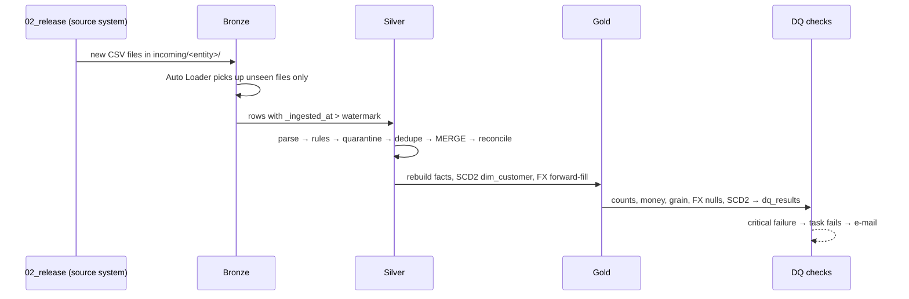

# Architecture

## Layers and Unity Catalog objects

All objects live in one catalog (default `workspace`, set with the `catalog` widget or job parameter).

| Schema | Objects | Written by |
|---|---|---|
| `bronze` | `orders`, `order_items`, `order_payments`, `customers`, `products`, `sellers`, `category_translation` (all columns STRING + `_rescued_data`, `_ingested_at`, `_source_file`, `_load_id`); `fx_rates_raw` (raw JSON payload); Volume `landing` | `03_bronze_ingestion` |
| `silver` | the same 7 entities, typed and cleaned (+ `_silver_updated_at`); `quarantine_<entity>`; `fx_rates` | `04_silver_transformations` |
| `gold` | `fact_order_items`, `fact_order_payments`, `dim_customer` (SCD2), `dim_product`, `dim_seller`, `dim_date`, `fx_rate_daily`; views `v_orders`, `v_dim_customer_current`; Volume `exports` | `05_gold_star_schema` |
| `ops` | `pipeline_run_log`, `dq_results`, `silver_watermarks` | every task |

## Landing Volume layout

```
/Volumes/<catalog>/bronze/landing/
  raw/olist/              the original Kaggle CSVs, uploaded once by hand
  incoming/<entity>/      files the pipeline ingests (monthly splits + simulated batches)
  checkpoints/bronze_<entity>/   Auto Loader state
```

`02_release_incoming_batches` stands in for a source system. It drops monthly files into `incoming/` so incremental loading can be tested on a static dataset.

## Run flow



## Key design decisions

| Decision | Why |
|---|---|
| Bronze columns are all STRING | Casting in Bronze would turn malformed values into NULL and hide them. Silver parses with `try_` functions and quarantines what fails. |
| Quarantine keeps **raw** values plus `failure_reason` | You can see exactly what the source sent, and nothing is silently dropped. |
| MERGE guard `s._ingested_at > t._ingested_at` | Corrections update existing rows; replays or stale rows never overwrite newer data. |
| Per-entity watermark in `ops.silver_watermarks` | Silver processes only new Bronze rows, which makes the reconciliation per-run and exact. |
| Two separate facts, no items × payments join | Different grains. Joining them multiplies rows and inflates revenue. |
| `dim_customer` keyed on `customer_unique_id`, SCD2 | Olist's `customer_id` changes with every order. Address history is kept. |
| FX: full calendar + forward-fill, starting at the first published rate | ECB has no weekend or holiday rates. Starting at the first rate guarantees day 1 has a seed. |
| Liquid clustering, no partitions | About 100k rows. Partitioning would only create small files. |
| Gold facts rebuilt each run | Idempotent and simple at this size. At larger sizes this would become an incremental MERGE driven by the Silver change data feed. |
| Logic in `src/`, notebooks thin | The same code is unit-tested with pytest locally and in CI. |

## Deployment

- **Git folder** in the workspace, linked to this GitHub repo.
- The Job is defined twice, and both definitions are equivalent:
  - `databricks.yml` (Asset Bundle, for the CLI: `databricks bundle deploy`).
  - `notebooks/08_create_job.py` (Databricks SDK, for workspaces without the CLI).
- GitHub Actions runs `pytest` on every push.
